
01 / Context

## Indopaket, beyond a shipping website.

Redesigning complex logistics journeys for customers and internal operations.

Indopaket is Indomaret Group's shipping platform. Sellers use it to manage shipments and track referral/tier status, while internal teams rely on it for operational visibility. I carried this web redesign from UX analysis through to production code.

**Role:** UX Engineer · Product Team Lead

**Scope:** UX analysis, information architecture, interaction design, and frontend implementation across 9 core flows

**Stack:** Laravel Blade · Tailwind CSS

Jump to: [Challenge](#challenge) · [Design decision](#design-decision) · [Store & shipping](#store-and-shipping-discovery) · [Account & authentication](#account-and-authentication) · [Implementation](#implementation) · [Outcome](#outcome)

The challenge

<h2 id="challenge">When every feature needs attention, the user loses direction.</h2>

The site had grown feature-by-feature. Primary actions were buried in unlabeled fields, store details obscured the map, and empty states offered no next step.

How might we make shipping, tracking, and store discovery easier to navigate without compromising operational requirements?

The starting evidence was Hotjar heatmap data from **1–30 September 2023**, paired with heuristic evaluation. The screenshots compare that original experience with the **2026 iteration**, following multiple rounds of changes—not a single redesign pass.

02 / Design decision

<h2 id="design-decision">Organizing around user tasks, not internal features.</h2>

I restructured the experience around tracking, checking rates, finding a store, and shipping a package. Clear labels and repeated interaction patterns help users recognize what to do without relearning each screen.

The business rules stayed intact. The design work focused on reducing the extra effort created by fragmented navigation, competing actions, and inconsistent feedback.

Constraints and trade-offs

- **Shared patterns:** stay consistent with components already used across Indopaket.
- **Business rules:** preserve operational and referral/tier logic owned by other teams.
- **Production stack:** work within Laravel/Blade and existing backend contracts.
- **Prioritization:** focus on store discovery, error states, and account flows. Single vs. multi-resi tracking ambiguity remains a follow-up item.

Journey / Store and shipping discovery

<h2 id="store-and-shipping-discovery">Keep the next shipping action in sight.</h2>

How sellers find a drop-off store and track a shipment.

### Beranda (Homepage)

*Surfaced tracking and rate-check as the homepage's primary actions, instead of leaving them buried in plain, unlabeled fields.*

Hotjar showed the heaviest interaction concentrated on the "Lacak Paket" (track) and "Cek Ongkir" (check rate) widgets, both of which buried their primary action in plain, unlabeled fields — and the promo slider had no visible pagination. *(Heuristic reference: Recognition Rather Than Recall.)*

| Existing experience · Sep 2023 | Current iteration · 2026 |
|---|---|
| 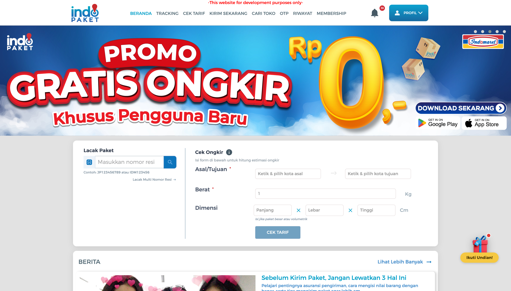 | 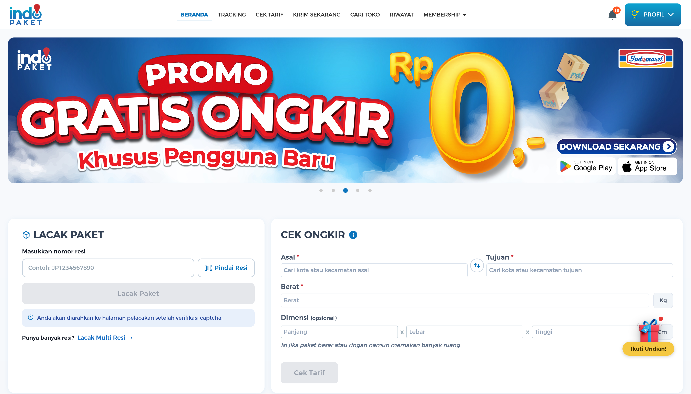 |

**What changed**

- **Slider** — added visible pagination dots and breathing room from the content below, instead of one static banner butting straight into the page
- **Lacak Paket** — added a "Pindai Resi" (scan) shortcut, a dedicated "Lacak Paket" button, and a note on what happens after submitting (captcha verification)
- **Cek Ongkir** — split the combined "Asal/Tujuan" field into two clearly labeled fields with a swap shortcut, and marked Dimensi as explicitly optional

### Cari Toko (Store Locator)

*Shifted store details from a map-blocking popup to a compact card that keeps the map and result list in view.*

Both versions kept a results list alongside the map. The problem was the selected-store popup: it was large enough to cover a significant part of the map, and closing it to check a different result meant losing sight of where the selected pin sat relative to the rest. *(Heuristic reference: Visibility of System Status.)*

| Existing experience · Sep 2023 | Current iteration · 2026 |
|---|---|
| 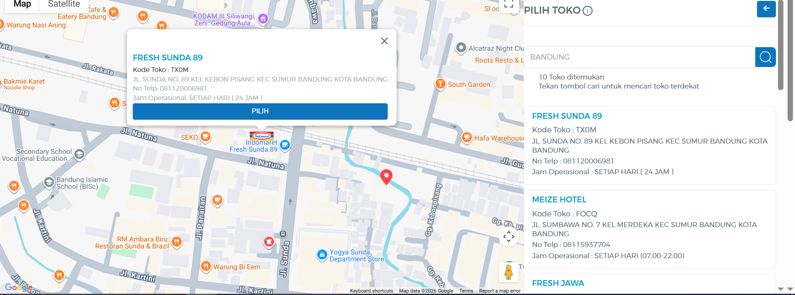 | 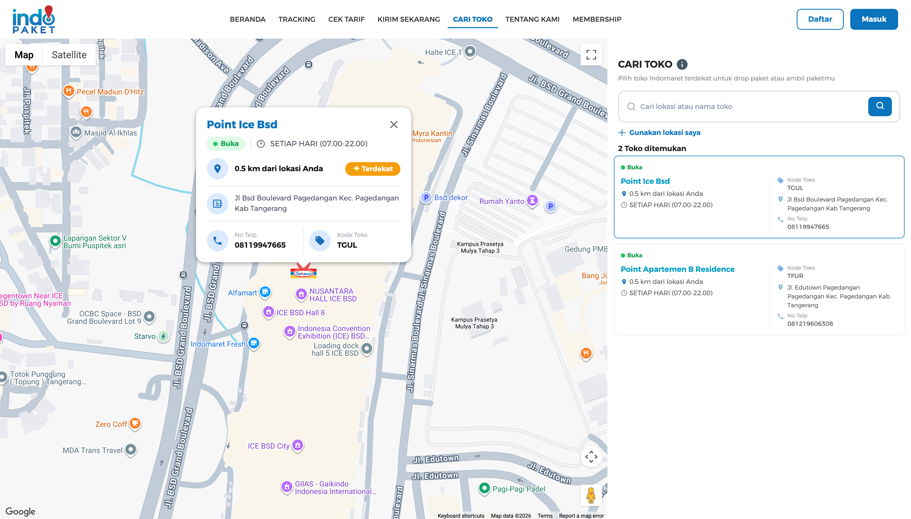 |

**What changed**

1. **Selected store card** — reduced in size and given a clear structure (status, distance, "Terdekat" badge, contact) so it obscures less of the map and surrounding results
2. **Result list** — the selected store is highlighted in the list, keeping map pin and list entry connected instead of relying on the popup alone
3. **No-results feedback** — a plain "0 Toko ditemukan" became an inline, actionable "Lokasi tidak ditemukan. Coba kata kunci lain."

| No results — Existing experience · Sep 2023 | No results — Current iteration · 2026 |
|---|---|
| 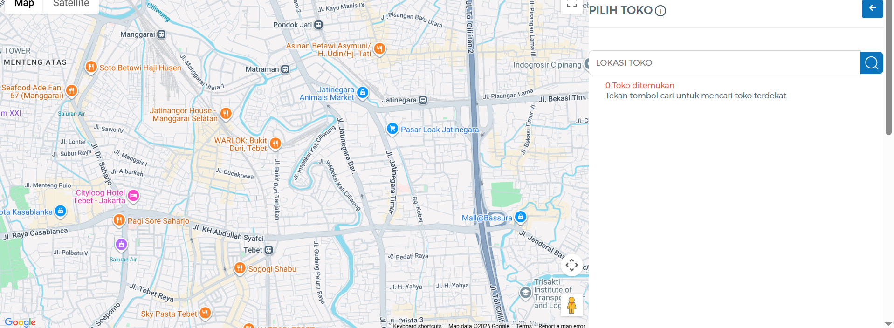 | 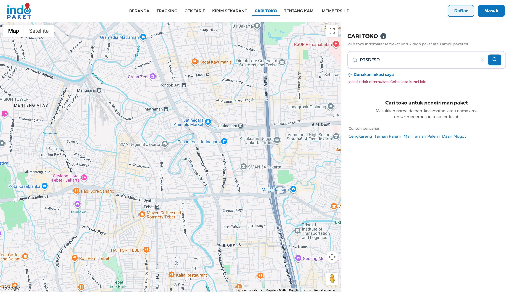 |

### Kirim Sekarang (Ship Package)

*Gave users stuck at the app-handoff screen an actual way forward, instead of a dead end.*

For "Jemput & Antar ke Alamat" deliveries, handing off to the mobile app used to be a bare card — one paragraph and a single button, with no fallback for users who didn't have the app installed yet.

| Existing experience · Sep 2023 | Current iteration · 2026 |
|---|---|
| 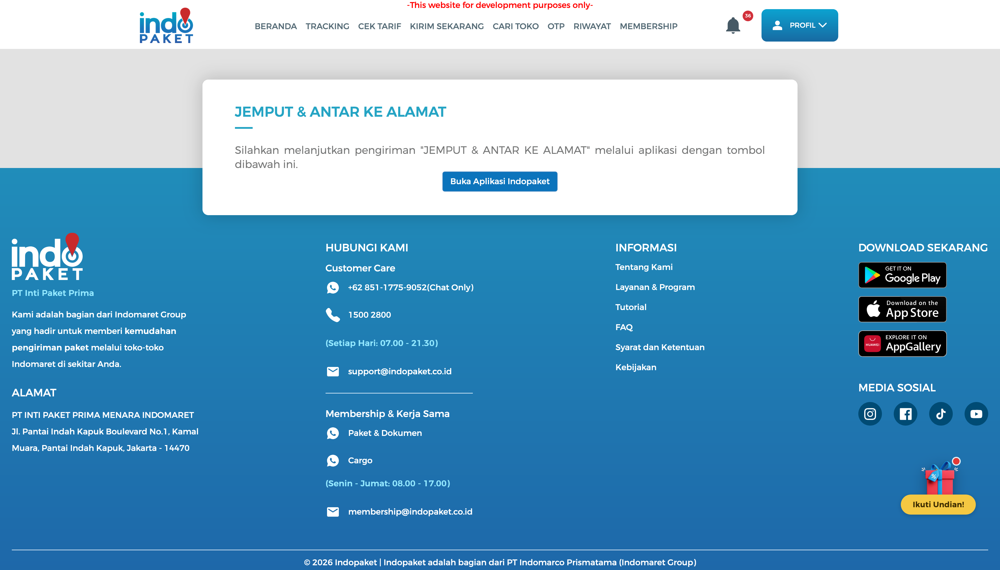 | 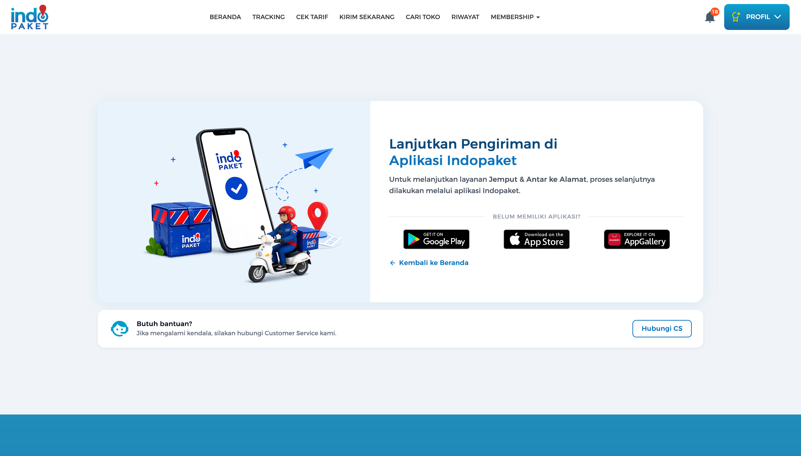 |

**What changed**

- Added Google Play / App Store / AppGallery badges for users who don't have the app yet, instead of dead-ending on a single "open the app" button
- Added a "Butuh bantuan? Hubungi CS" fallback card for users who get stuck mid-handoff
- Replaced the bare text card with an illustration consistent with the rest of the site's redesigned states

### Riwayat & Tracking

*Turned a broken-image dead end into a self-diagnosis state users can act on.*

The old "not found" state on Riwayat (History) was a bare "Tidak ditemukan" message with a broken image and no guidance. *(Heuristic reference: Help Users Recognize, Diagnose, and Recover from Errors.)* The old multi-resi tracking input also drew scattered heatmap clicks with no clear pattern — a sign users weren't sure how single-resi tracking differed from tracking multiple resi at once.

| Existing experience · Sep 2023 | Current iteration · 2026 |
|---|---|
| 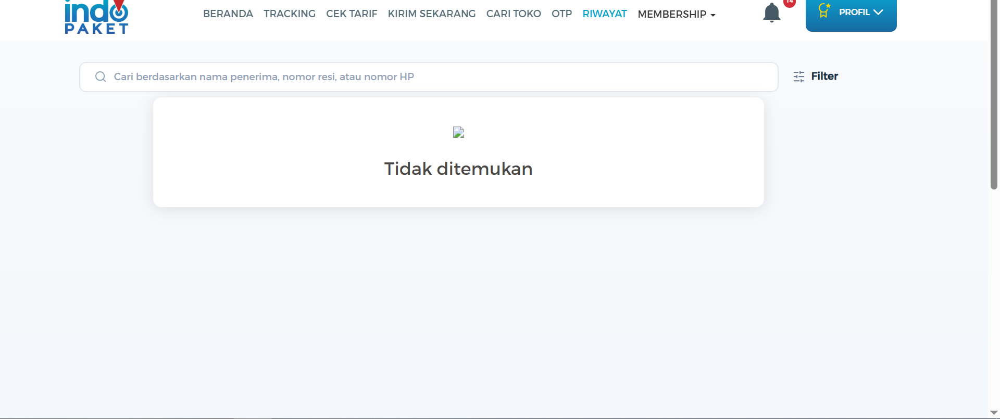 | 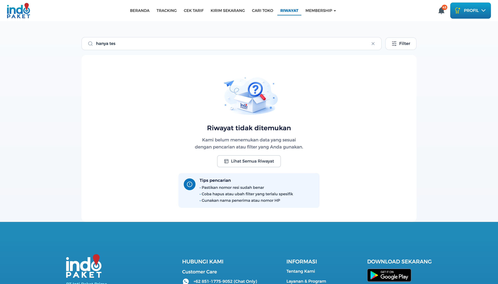 |
| 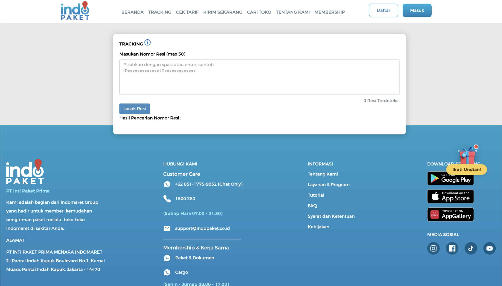 | 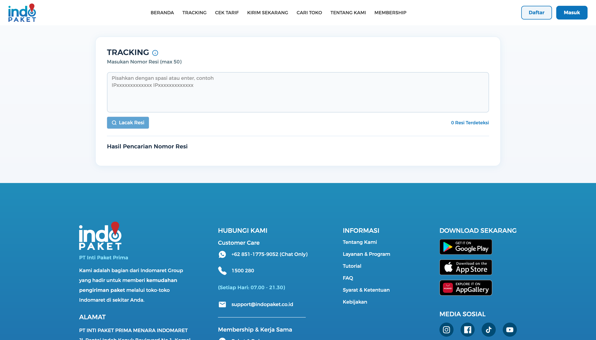 |

**What changed**

- Riwayat's broken-image dead end became an illustration + headline + self-diagnosis checklist — the same pattern now backs the Tracking page's resi-not-found result too, so error states feel consistent instead of one-off
- Tracking input got a visual refresh, though the underlying single vs. multi-resi ambiguity is still an open item for a follow-up iteration, not solved here (see [Constraints & Trade-offs](#design-decision))

---

Journey / Account and authentication

<h2 id="account-and-authentication">One purpose per screen. Clear guidance at each step.</h2>

How a new user registers and verifies their account.

### Login and Register

*Split a screen where two flows competed for attention into two focused, single-purpose ones.*

| Daftar (Register) — Existing experience · Sep 2023 | Daftar (Register) — Current iteration · 2026 |
|---|---|
| 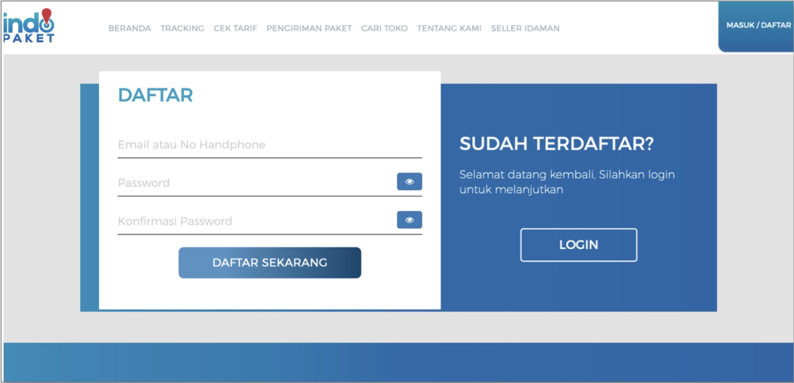 | 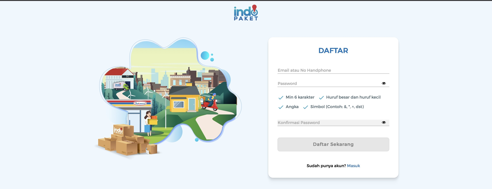 |

The registration form and the "Sudah Terdaftar? Login" panel used to compete on one screen — heatmap data showed clicks scattered across both. Login and Register are now distinct, focused pages instead of one competing screen. *(Heuristic reference: Aesthetic and Minimalist Design.)*

### OTP Verification

*Replaced a bare countdown with confirmation of what's happening and what to do if it doesn't.*

| Kode Verifikasi (OTP) — Existing experience · Sep 2023 | Kode Verifikasi (OTP) — Current iteration · 2026 |
|---|---|
| 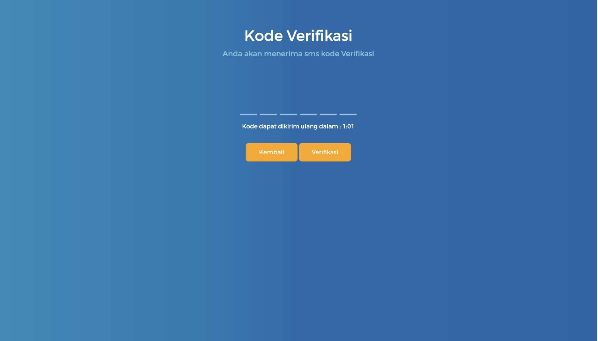 | 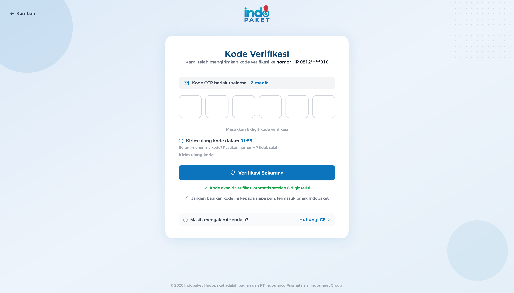 |

The old screen only showed a countdown and a bare set of input boxes — no confirmation of which number the code went to, no reassurance about what to do if it didn't arrive. The redesign shows the masked destination number ("nomor HP 0812\*\*\*\*\*\*010"), how long the code is valid, what to do if it hasn't arrived, and a reminder not to share the code with anyone, including Indopaket staff. *(Heuristic reference: Recognition Rather Than Recall.)*

---

Delivery / Design to engineering

<h2 id="implementation">Carry the interaction decisions into production.</h2>

I owned the heatmap review, heuristic evaluation, information architecture, interaction design, and frontend implementation. I worked with backend engineers on API contracts and with business stakeholders on operational and referral rules.

The redesign shipped in the existing **Laravel Blade** frontend with **Tailwind CSS**. Reusable empty states, store-selection cards, and form layouts let the team extend the experience without introducing a parallel design language.

03 / Outcome

<h2 id="outcome">A clearer foundation for future journeys.</h2>

**9 core flows redesigned and shipped** on the live Indopaket web platform. The before-and-after evidence shows concrete interface changes:

- **Discovery:** labeled shipping actions and a smaller store card that keeps the map and results visible.
- **Recovery:** useful empty states, app-store links, and a customer-support fallback in place of dead ends.
- **Account flows:** separate Login/Register pages and OTP guidance that confirms the destination and explains recovery.
- **Engineering:** production templates and reusable patterns the team can maintain.

These are delivered interface changes; this case study does not report a measured improvement in conversion or task completion.

**Still to resolve:** the distinction between single and multi-resi tracking. A planned React/Next.js rewrite is an opportunity to consolidate the patterns introduced here into a more reusable frontend architecture.
