import CaseStudyVisual from "@/components/CaseStudyVisual.astro";

## A little context

Indopaket Web is the core customer web product within Indomaret Group. I carried the redesign from UX analysis through production implementation across nine core flows.

**My part:** UX analysis, information architecture, interaction design, and Laravel Blade/Tailwind CSS implementation as UX Engineer and Product Team Lead.

**Collaboration:** I worked with backend engineers and business stakeholders to keep the redesign compatible with existing shipping requirements.

<h2 id="impact-summary">What changed at a glance</h2>

**Nine flows redesigned across six customer journeys, from UX analysis through production implementation.** The delivered changes include explicit tracking and rate-check actions, compact store details, recovery guidance, and focused account pages.

The clearest example: selected-store details now sit in a compact card, keeping the map and result list visible together.

| Earlier store selection | Delivered redesign |
|---|---|
| 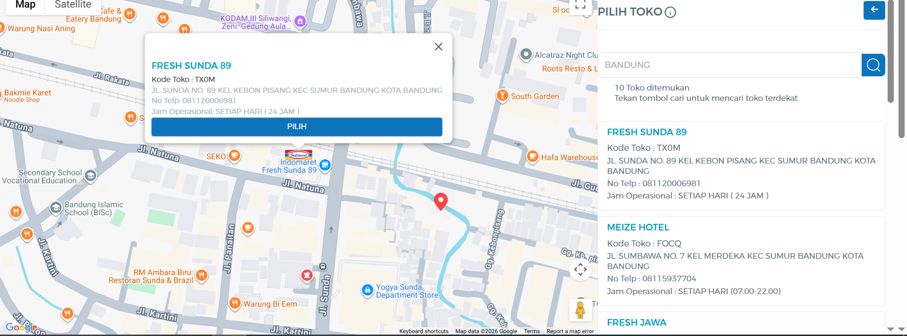 | 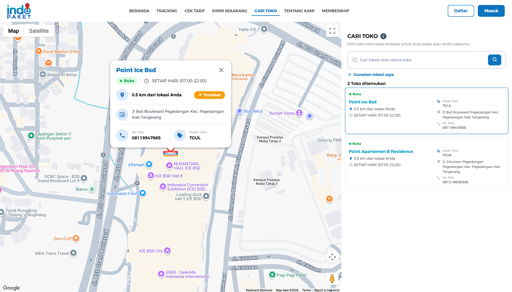 |

This is evidence of an interface change. Conversion and task-completion improvements have not been measured.

<h2 id="challenge">Product Challenge</h2>

Primary shipping actions were buried in unlabeled fields, store details obscured the map, and empty states offered no next step. Hotjar data from September 2023 and heuristic evaluation informed the changes shown in the 2026 iteration.

<h2 id="design-decision">Three decisions, with the evidence behind them</h2>

### 1. Make the main shipping actions explicit

Hotjar showed the heaviest interaction concentrated on the "Lacak Paket" (track) and "Cek Ongkir" (check rate) widgets, both of which buried their primary action in plain, unlabeled fields — and the promo slider had no visible pagination. *(Heuristic reference: Recognition Rather Than Recall.)*

| Existing experience · Sep 2023 | Current iteration · 2026 |
|---|---|
| 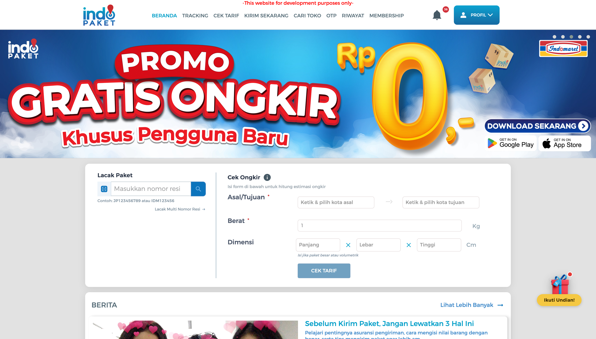 | 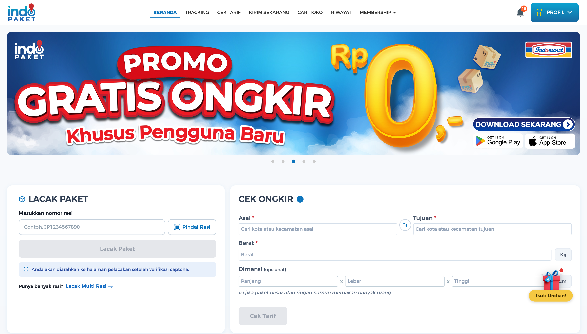 |

**What changed**

- **Slider** — added visible pagination dots and breathing room from the content below, instead of one static banner butting straight into the page
- **Lacak Paket** — added a "Pindai Resi" (scan) shortcut, a dedicated "Lacak Paket" button, and a note on what happens after submitting (captcha verification)
- **Cek Ongkir** — split the combined "Asal/Tujuan" field into two clearly labeled fields with a swap shortcut, and marked Dimensi as explicitly optional

**Trade-off:** Labels and guidance take space. I prioritized the tracking and rate-check actions while leaving the single-versus-multiple tracking interaction for a follow-up iteration.

### 2. Keep store details in context

Both versions kept a results list alongside the map. The problem was the selected-store popup: it was large enough to cover a significant part of the map, and closing it to check a different result meant losing sight of where the selected pin sat relative to the rest. *(Heuristic reference: Visibility of System Status.)*

[Compare the selected-store interfaces in the opening summary ↑](#impact-summary)

**What changed**

1. **Selected store card** — reduced in size and given a clear structure (status, distance, "Terdekat" badge, contact) so it obscures less of the map and surrounding results
2. **Result list** — the selected store is highlighted in the list, keeping map pin and list entry connected instead of relying on the popup alone
3. **No-results feedback** — a plain "0 Toko ditemukan" became an inline, actionable "Lokasi tidak ditemukan. Coba kata kunci lain."

| No results — Existing experience · Sep 2023 | No results — Current iteration · 2026 |
|---|---|
| 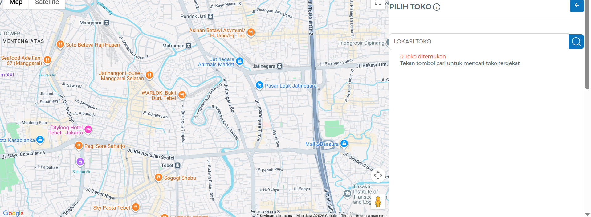 | 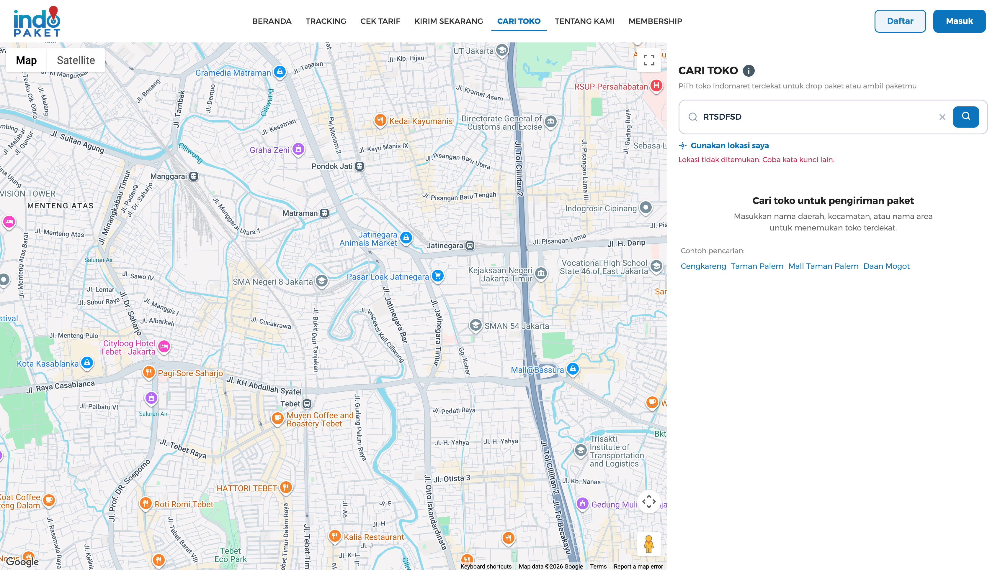 |

**Trade-off:** A compact card cannot give every detail equal prominence. I prioritized status, distance, and contact information while keeping map and list context available.

### 3. Give interrupted journeys a next step

**Trade-off:** Recovery guidance can compete with the primary action. I kept it tied to the situation: an app handoff, an empty result, or account verification.

#### Kirim Sekarang (Ship Package)

*Gave users stuck at the app-handoff screen an actual way forward, instead of a dead end.*

For "Jemput & Antar ke Alamat" deliveries, handing off to the mobile app used to be a bare card — one paragraph and a single button, with no fallback for users who didn't have the app installed yet.

| Existing experience · Sep 2023 | Current iteration · 2026 |
|---|---|
| 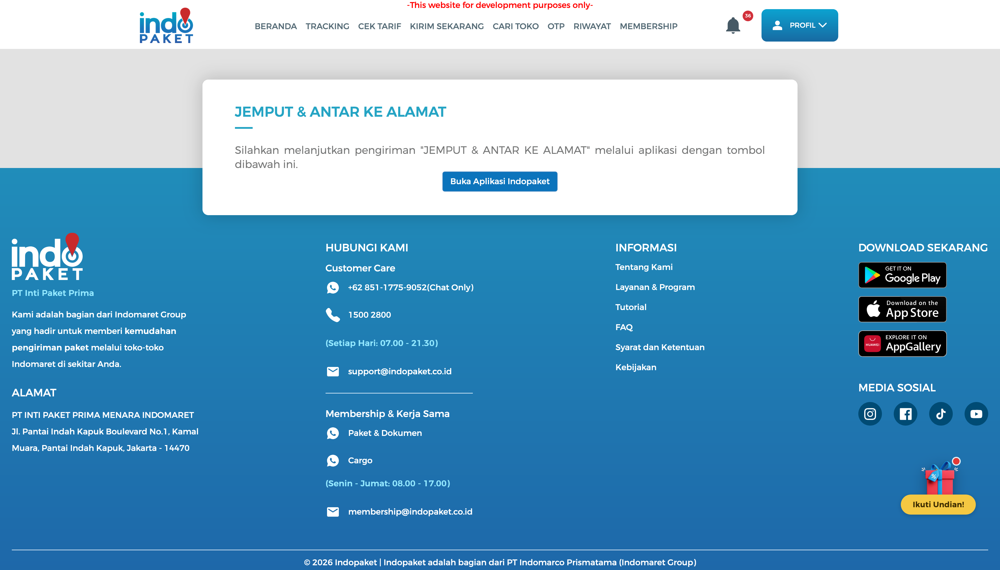 | 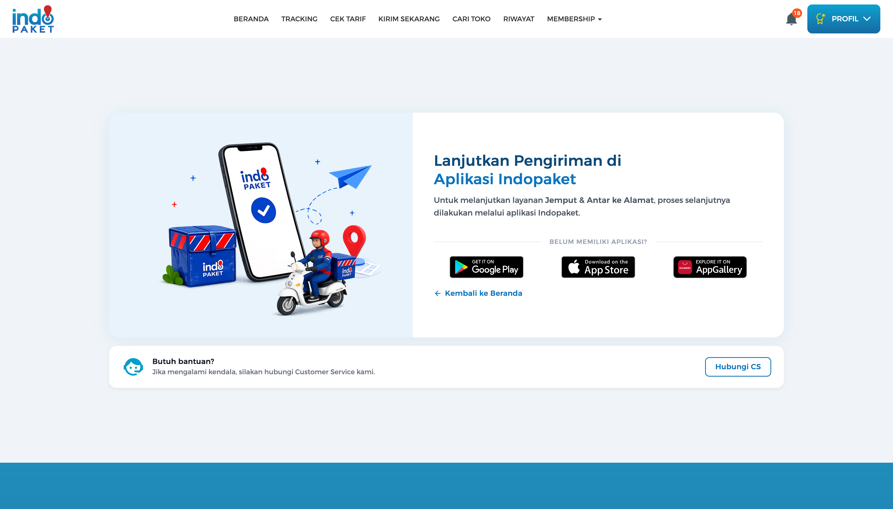 |

**What changed**

- Added Google Play / App Store / AppGallery badges for users who don't have the app yet, instead of dead-ending on a single "open the app" button
- Added a "Butuh bantuan? Hubungi CS" fallback card for users who get stuck mid-handoff
- Replaced the bare text card with an illustration consistent with the rest of the site's redesigned states

#### Riwayat & Tracking

*Added search tips and a next step when no history was found.*

The old "not found" state on Riwayat (History) was a bare "Tidak ditemukan" message with a broken image and no guidance. *(Heuristic reference: Help Users Recognize, Diagnose, and Recover from Errors.)* The old multi-resi tracking input also drew scattered heatmap clicks with no clear pattern. This suggested the distinction between single and multiple shipment tracking needed a closer look.

| Existing experience · Sep 2023 | Current iteration · 2026 |
|---|---|
| 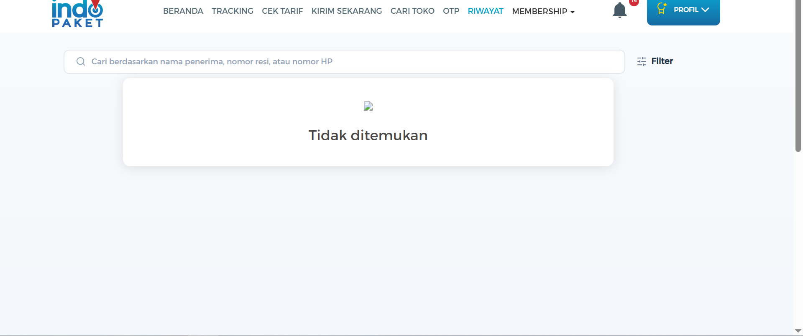 | 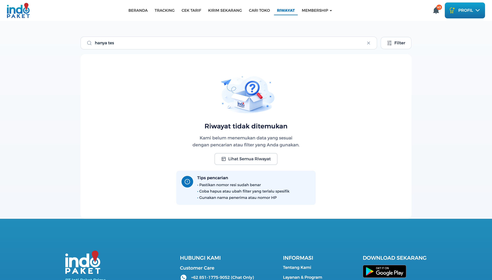 |
| 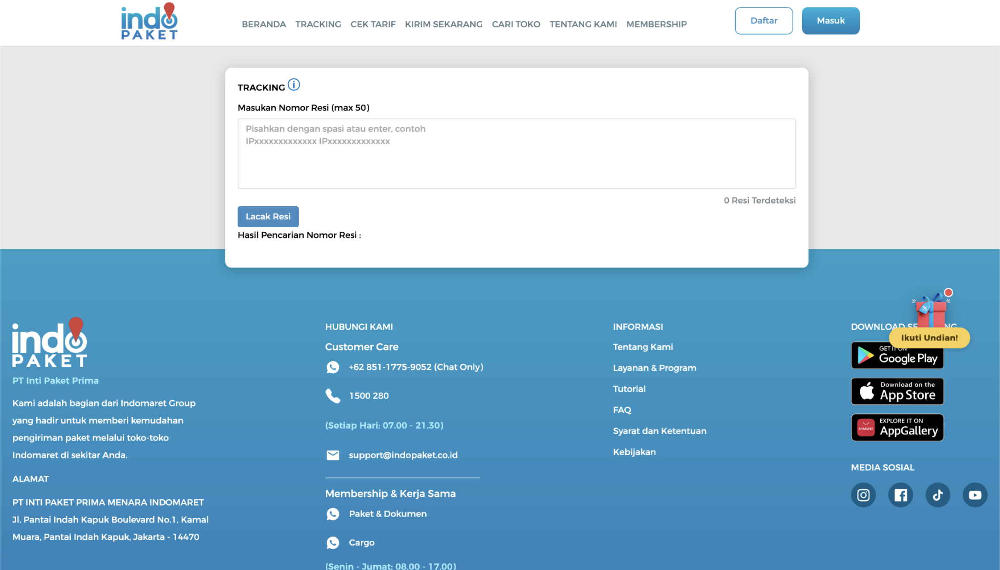 | 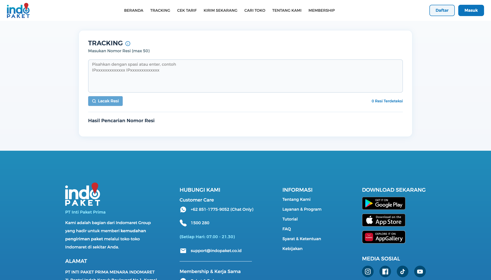 |

**What changed**

- Riwayat's broken-image dead end became an illustration + headline + self-diagnosis checklist — the same pattern now backs the Tracking page's resi-not-found result too, so error states feel consistent instead of one-off
- Tracking input got a visual refresh, though the underlying single vs. multi-resi ambiguity is still an open item for a follow-up iteration, not solved here (see [Future Exploration](#future-exploration))

---

<h4 id="account-and-authentication">Account and authentication</h4>

How a new user registers and verifies their account.

#### Login and Register

*Split a screen where two flows competed for attention into two focused, single-purpose ones.*

| Daftar (Register) — Existing experience · Sep 2023 | Daftar (Register) — Current iteration · 2026 |
|---|---|
| 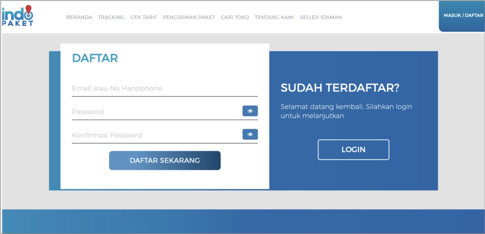 | 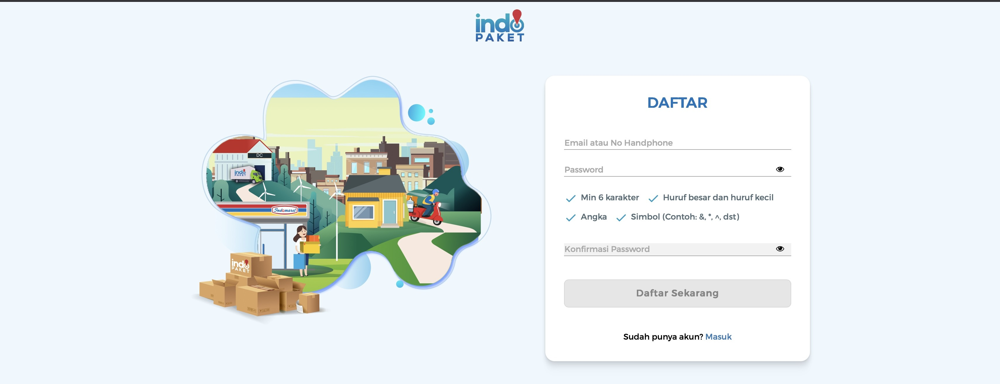 |

The registration form and the "Sudah Terdaftar? Login" panel used to compete on one screen — heatmap data showed clicks scattered across both. Login and Register are now distinct, focused pages instead of one competing screen. *(Heuristic reference: Aesthetic and Minimalist Design.)*

#### OTP Verification

*Replaced a bare countdown with confirmation of what's happening and what to do if it doesn't.*

| Kode Verifikasi (OTP) — Existing experience · Sep 2023 | Kode Verifikasi (OTP) — Current iteration · 2026 |
|---|---|
| 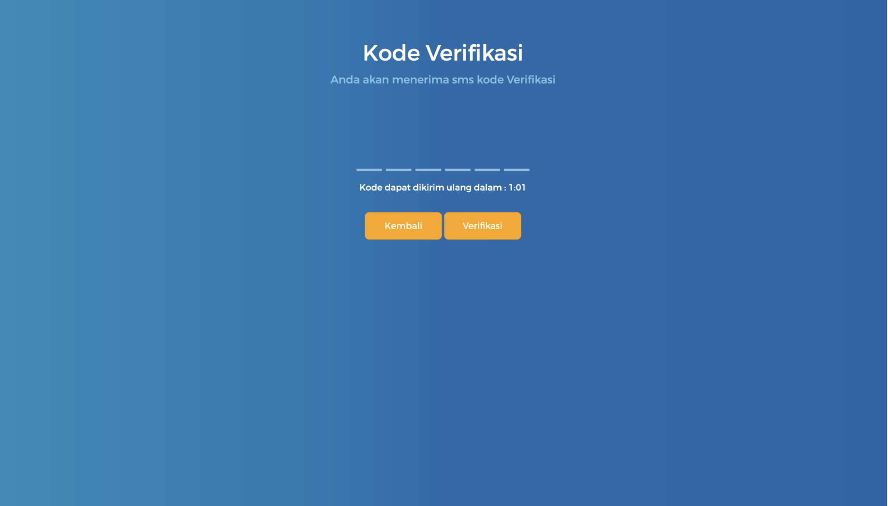 | 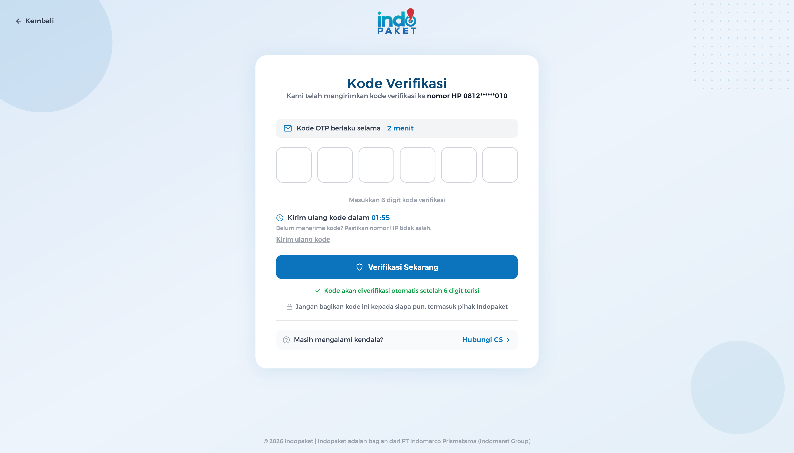 |

The old screen only showed a countdown and a bare set of input boxes — no confirmation of which number the code went to, no reassurance about what to do if it didn't arrive. The redesign shows the masked destination number ("nomor HP 0812\*\*\*\*\*\*010"), how long the code is valid, what to do if it hasn't arrived, and a reminder not to share the code with anyone, including Indopaket staff. *(Heuristic reference: Recognition Rather Than Recall.)*

---

<h2 id="implementation">Architecture and Implementation</h2>

<CaseStudyVisual items={[{"title": "Existing production stack", "description": "Delivered the redesign in Laravel Blade with Tailwind CSS while preserving business requirements."}, {"title": "Reusable interface patterns", "description": "Shared empty states, store-selection cards, and form layouts support consistent future changes."}]} kind="cards" label="Web implementation" />
<h2 id="outcome">Outcome: delivered changes</h2>

The redesign was implemented in the existing Laravel Blade/Tailwind CSS stack across nine flows. The comparisons above document the delivered interface changes. Conversion and task completion have not been measured.

## Learnings and validation next steps

A recovery state is part of the journey: it needs to help someone decide what to try next. The same principle shaped store search, shipment history, and account verification.

The September 2023 Hotjar observations helped prioritize the work, but do not validate the 2026 version. Next, I would observe people finding a store, recovering from an empty result, and verifying an account, recording task completion and points of hesitation to guide the next iteration.

<h2 id="future-exploration">What I’d explore next</h2>

The distinction between single and multi-shipment tracking remains unresolved. A planned React/Next.js rewrite offers an opportunity to consolidate the interaction patterns; it is not part of the delivered redesign.
